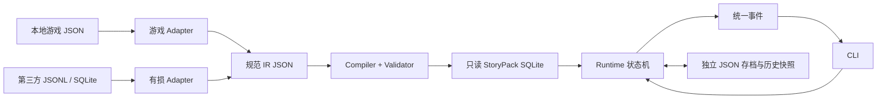

# Architecture / 架构

版本 1.1.0，Python 3.11+。运行时与任何游戏格式、提取工具和网络模块解耦。

## 模块边界

| 模块 | 职责 | 不能依赖 |
| --- | --- | --- |
| adapters | 原始结构 → 规范图，来源及文件哈希 | CLI、运行时状态 |
| compiler | 验证、确定性排序、原子构建 | 游戏专有字段 |
| storypack | SQLite 写入与只读访问、Schema 检查 | 上游资源、网络 |
| runtime | 图执行、条件/状态、选择、存档及回溯 | Adapter、终端、游戏 JSON |
| cli | 事件呈现、选项输入、命令编排 | 游戏流程推断 |
| validation | 静态诊断及使用 Runtime 的有界探索 | 第三方提取程序 |

中间表示直接采用可序列化 dataclass；不引入运行时插件发现框架或复杂 ORM。
新增 Adapter 只需要输出 `Bundle`，节点类型与边语义须保持统一。

## 原有 HSR 会话适配路径（兼容 1.0）

`OnStartSequece` 不是剧情数组。各 `TaskList` 是并发序列，其内部任务和
`SimpleTalkList` 是有顺序的指令流。当前仅降低已观察到的串行叙事子集：

1. 一个可识别的非等待入口；额外纯表现序列仅保留来源与信息诊断。
2. 序列末尾的选项/触发器，且事件在当前文件只有一个等待者。
3. 明确的 `EndPerformance` 结束会话。

也支持实际观察到的 PlaySimpleTalk 紧邻 WaitSimpleTalkFinish 指令对；
仅在有显式等待且中间没有其他任务时将其按串行台词执行。独立异步播放仍然阻塞。

遇到并发控制、额外初始化、非末尾 handoff、动态条件或未知控制字段即阻塞。
不按台词编号生成连接，不把等待事件名中的编号当作播放台词的证据。
`PlayTimeline` 可能携带缺失台词，保持 unknown，不当作可忽略动画。
完整任务与 Act 之间的世界状态调度尚未实现，每个 Act/Discussion 单独成为会话。
任务原 ID 与章节信息用于归属和浏览，不用于推断执行顺序。

## 执行和一致性

Runtime 沿显式边执行，不维护“台词列表索引”。对话事件发出后，指针移动到下一句未读节点；
选择事件直到 `choose()` 成功前保持不变。两个选项可有相同目标，但保留不同边和选择值。
分支节点必须恰好命中一个条件。未定义变量、歧义、缺失目标或未知指令均返回 BlockedEvent。
自动步骤有上限，重复状态也会暂停。状态包含当前任务、节点、变量、事件、选择历史和任务上下文。

`back()` 恢复最近一次选择之前的完整状态快照，同时撤销此后的选择。
快照不嵌套历史，避免递归存档；选择较多时历史仍会增长，尚无自动压缩。
`enter`/`exit` 使用显式跨任务边与上下文栈，不根据任务名或 ID 自动跳转。
通用 IR 可表达条件、变量和事件；并不表示已翻译原游戏所有谓词。

包通过规范 IR、源文件哈希、Schema、编译器版本和验证语言计算 SHA-256 标识。
相同输入、工具链下可得到字节一致的 SQLite 文件；不承诺跨 SQLite 版本的物理字节一致。
内容变化导致存档兼容性检查失败，格式升级须显式迁移。当前没有已有旧版 Schema，
故未实现空壳迁移器，读取器会拒绝未知版本。

## 验证边界

静态检查包括重复 ID、文本和目标引用、入口、节点/边类型、条件语法、无法到达的节点、
无法到达结束的路径、可能的环和明显的歧义。不能证明的条件覆盖、外部等待会被标记受限。
RESOLVED 仅表示这个会话静态检查没有已知问题；并非完整原游戏任务的兼容性认证。

有界探索合并相同执行状态，报告执行过的选项边、结束状态、阻塞与截断情况。
不同选择汇合到相同状态后可能只记录一个结束状态，不把结束状态数解释为完整路径数。
任意初始变量、外部游戏世界事件及巨大状态空间不在自动穷举承诺范围。

## M5 主线编译路径

`hsr/manifest.py` 按 MainMission.Type 和 MainMissionType 的实际标签分类；
`MissionInfo` 提供开始与完成子任务，`.partial.json` 提供声明的依赖、控制文件与完成条件。
显示优先级只用于下载抽样和菜单，不产生执行边。

`compiler/hsr_mainline.py` 链接任务、控制脚本和 Performance 表中的明确路径，
把 TriggerPerformance 转为通用 call/return。每个调用点分别存储 callee 入口和 continuation；
return 边列出合法返回地址，运行时只允许返回当前调用帧的地址。
候选边的静态遍历会过近似调用上下文，因此 M5 单独使用实际 Runtime 验证，不把静态可达当作完整可玩。

子任务调度使用显式依赖和完成状态；多个同时满足的路径会报告歧义，未模拟游戏世界。
Talk 完成需要脚本产生与定义 ParamStr1 对应的事件，并检查 Equal / Progress=1。
未理解的 FinishActionList、世界条件、并发或异步控制仍然阻塞。

引用收集与执行解耦：即使父指令不支持，仍收集其中明确声明的资源和台词作为静态证据，
但不给未知父节点编造跳转。任务、子任务片段和演出片段分别标记，覆盖率仅按任务层计算。
角色移动等可跳过的演出不被转成世界状态成功事件。

`hsr/sources.py` 管理明确的来源优先级、来源版本、内容哈希和冲突。
未知版本的补充控制资源不会自动执行；有损导出只作有来源的候选证据。
完整原始控制对象以 SHA-256 去重存入 metadata.resource_blobs，source_refs 保存逻辑路径及指针。
原生 Timeline 和二进制容器的限制见 M5 报告。
# M5.9 构建时调度

`compiler.schedule` 将有明确契约的动作、逻辑时间、依赖和事件等待转换为既有 set/wait/emit/dialogue/return 节点。
每条调度使用独立时钟变量，等待期间不推进；同刻动作没有明确依赖时阻塞，结束策略未证明时不生成成功返回。
这不增加 Runtime 的 Unity 或 HSR 依赖。

`hsr.native_scheduler` 读取已核验的原生对象并构建 Track 层级与 Clip 调度事实。
原生激活条件、Marker 恢复契约和退出策略未证明时生成受阻调用图；静态结构可解析不代表调度可执行。
其版本匹配的 IR 可以通过主线编译器的 `native_bundles` / CLI `--native-ir` 链接，未知语义继续传递至调用点。
原生库记录使用独立 NATIVE_LIBRARY 范围，不计作完整任务或已完成片段。

`hsr.native_scan` 为构建阶段提供持久化扫描状态与精确资源查询。
索引使用 WAL 和独立只读快照支持与解析并行；内容变化保留旧版本并重新扫描。
当前安装的查询绑定包清单、路径、大小和修改时间快照；内容 SHA256 在扫描阶段验证，查询报告明确注明这个边界。
